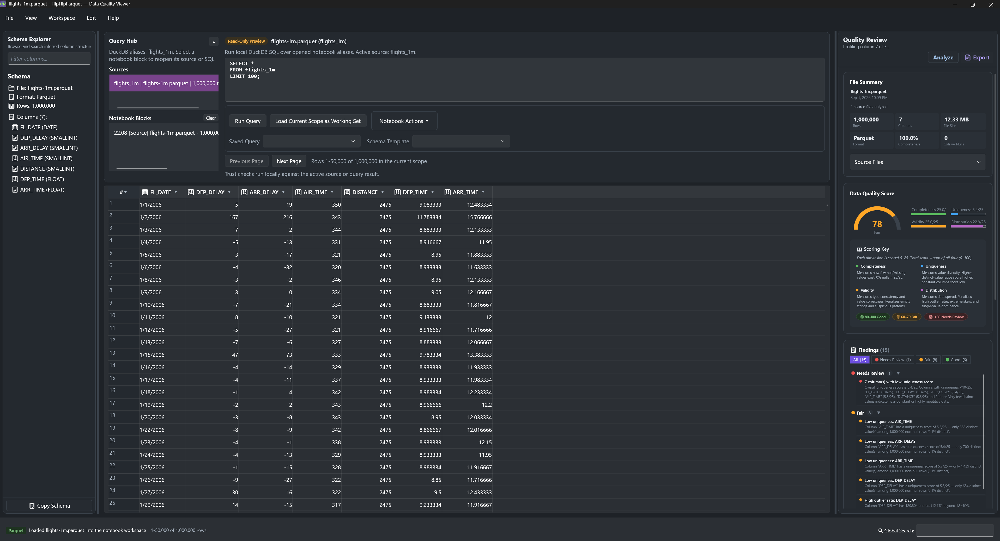
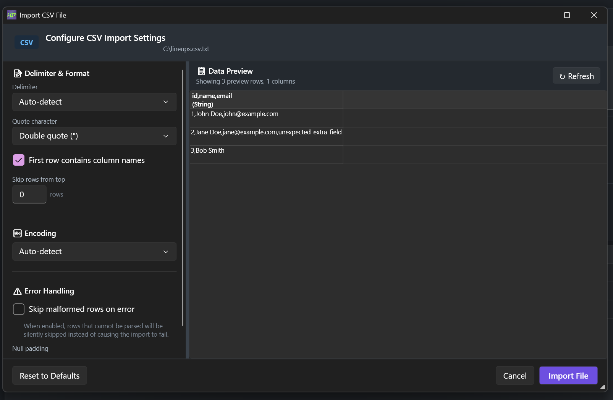
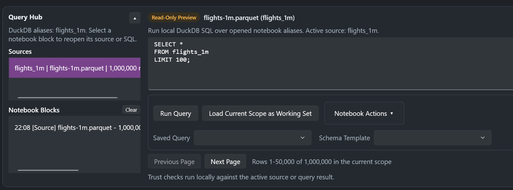
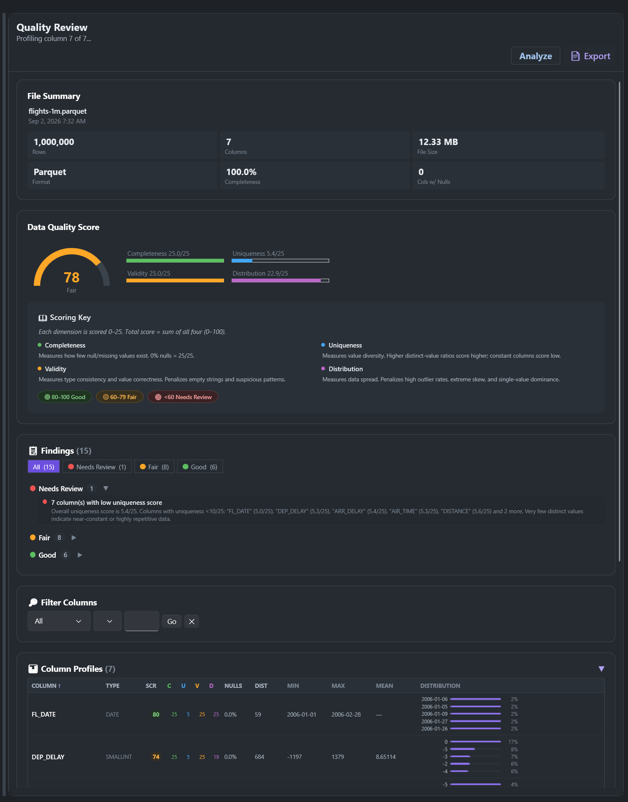
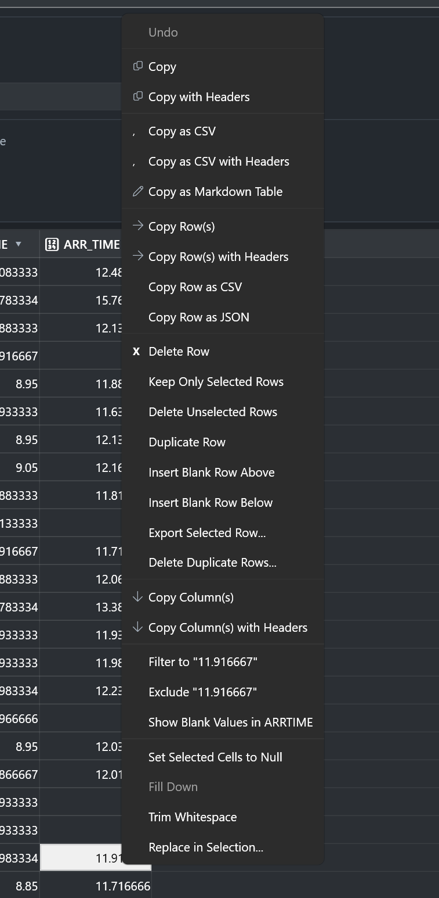

# Hip Hip Parquet

**Open the file. Interrogate it. Fix it. Never upload it.**

A free Windows desktop app that opens Parquet, CSV, JSON and Excel files, runs SQL across them with DuckDB, scores their quality, and lets you fix problems in the grid and save back — all on your own machine, with no account and no service behind it.

[](https://dotnet.microsoft.com/download/dotnet/10.0)
[](#technical-stack)
[](LICENSE)
[](https://github.com/jhew/HipHipParquet/releases/latest)

**[Download for Windows](https://github.com/jhew/HipHipParquet/releases/latest)** · [Website](https://hiphipparquet.com) · [Report an issue](https://github.com/jhew/HipHipParquet/issues)



<sub>`flights-1m.parquet` — 1,000,000 rows, 7 columns, 12.33 MB, scored 78/100 with 15 findings.</sub>

---

## Contents

- [Requirements](#requirements)
- [Install](#install)
- [Supported formats](#supported-formats)
- [What it does](#what-it-does)
- [Keyboard shortcuts](#keyboard-shortcuts)
- [Network access](#network-access)
- [Build from source](#build-from-source)
- [Technical stack](#technical-stack)
- [Project layout](#project-layout)
- [Contributing](#contributing)
- [License](#license)

---

## Requirements

| | |
| --- | --- |
| **OS** | Windows 10 build 19041 or later, 64-bit (x64) |
| **Runtime** | [.NET 10 Desktop Runtime](https://dotnet.microsoft.com/download/dotnet/10.0) (x64) |
| **Markdown preview** | [Microsoft Edge WebView2 Runtime](https://developer.microsoft.com/microsoft-edge/webview2/) — preinstalled on Windows 11 and most up-to-date Windows 10 machines |

Release builds are framework-dependent, so the .NET 10 Desktop Runtime must be installed. A machine with only .NET 8 will not run the app.

## Install

Every release ships three files on the [releases page](https://github.com/jhew/HipHipParquet/releases/latest):

| File | Use it when |
| --- | --- |
| `HipHipParquet-<version>-Setup.exe` | You want a normal install with a Start menu entry. Recommended. |
| `HipHipParquet-<version>-Portable.zip` | You can't run installers. Extract anywhere and run `HipHipParquet.exe` — no registry writes, no admin rights. |
| `HipHipParquet-<version>-SHA256SUMS.txt` | You want to verify what you downloaded. |

To verify a download in PowerShell:

```powershell
Get-FileHash .\HipHipParquet-<version>-Setup.exe -Algorithm SHA256
```

Compare the result with the matching line in `SHA256SUMS.txt`.

Once installed, **Help › Check for Updates** downloads new versions and verifies the checksum and Authenticode signature before running the installer.

---

## Supported formats

| Format | Read | Write |
| --- | --- | --- |
| Parquet (`.parquet`, `.pqt`) | Yes | Yes |
| Snappy-compressed Parquet | Yes | Yes |
| Split / sharded Parquet | Yes | As one combined file |
| CSV / TSV / TAB | Yes | Yes |
| JSON / JSONL / NDJSON | Yes | Yes |
| Excel (`.xlsx`) | Yes | Yes |

Legacy Excel workbooks (`.xls`) aren't supported. Open them in Excel and save as `.xlsx` first.

Excel files are read and written through DuckDB's spatial extension, which is downloaded the first time you open or export an Excel file. See [Network access](#network-access). Columns that Excel can't hold natively — UUIDs, times, intervals, very large integers, lists and structs — are written to `.xlsx` as text.

---

## What it does

### Open the file you actually have

Open files from the File menu, the recent files list, the taskbar Jump List, by dragging them onto the window, or by passing a path on the command line. Sharded and multi-part Parquet is stitched into one logical table automatically.

CSV, TSV and JSON open through an import dialog first, so you can set the delimiter, encoding, quote character, header row and malformed-row handling before anything is guessed wrong. Nested JSON can be flattened into columns with **Flatten Nested JSON**.

Large files are shown a page at a time — 50,000 rows per page, with the status bar showing where you are (for example, *Rows 1–50,000 of 1,000,000 in the current scope*). Long loads show progress on the taskbar.

On startup the app restores your last workspace: the file, pane sizes and visibility.



### Ask it a question in SQL — the Query Hub

The Query Hub sits above the grid and runs [DuckDB](https://duckdb.org) SQL against your local files. Register one or more files as named aliases and query or join across them with standard SQL. There is no import step and no database to run.

- Query results open as a **Read-Only Preview**. Use **Load Current Scope as Working Set** to make them the editable data in the grid.
- Save frequently used queries by name and load them again later.
- Each transformation and query step is recorded as a notebook block that you can remove individually or clear in bulk.
- **Notebook Actions** run one-click checks for nulls and empty values, duplicates, and regex pattern matches.
- **Schema templates**: save the schema of a known-good file, then validate incoming files against it.
- Collapse the Query Hub to a slim bar when you need the grid space.



### Find out whether the data is any good — Quality Review

Quality Review scores the current dataset on four dimensions, each worth 0–25 points, which add up to a score out of 100:

| Dimension | Measures |
| --- | --- |
| **Completeness** | Proportion of non-null values per column |
| **Uniqueness** | Ratio of distinct values to total rows |
| **Validity** | Conformance to expected patterns and types |
| **Distribution** | Balance and spread of values in each column |

The total is banded **Good** (80–100), **Fair** (60–79) or **Needs Review** (below 60), so you can see which dimension cost you points.

- Findings are written in plain English — for example, *DEP_DELAY has 120,804 outliers, 12.1%, beyond 1.5×IQR* — and can be filtered and sorted by severity.
- The per-column profile shows null rate, distinct count and ratio, outlier rate, and value distribution.
- When comparing files, a side-by-side **Schema Diff** shows which columns were added, removed or changed type.
- A **Refresh recommended** badge appears when the data has changed since the last analysis. Long analyses can be cancelled.
- Export the results as a single self-contained HTML report you can send to someone.

The **File Summary** card shows rows, columns, file size, format, completeness and columns with nulls before you read a single value.



### Fix it here, not somewhere else

An opened file is editable. Double-click a cell or start typing. A pending-changes badge in the status bar tracks unsaved edits, with a quick-save button beside it.

| Kind | Operations |
| --- | --- |
| **Rows** | Delete, delete unselected, keep only selected, duplicate, insert blank above or below, delete duplicate rows |
| **Cells** | Set to null, fill down, trim whitespace, replace in selection |
| **Filters** | Filter to this value, exclude this value, show blank values — straight from the grid's right-click menu |

- **Ctrl+Z** undoes the last edit. **Ctrl+S** saves back to the original file, keeping each column's original type where the format supports it. A set of sharded Parquet files is saved as one combined file.
- **Save As** and **Export As** write to a new file or a different format — open a CSV, save a Parquet.
- **Export Current Scope** and **Export Selected Rows** write out only what you're looking at.



### Copy out in the format you need

Copy a selection as plain text, with headers, as CSV, as TSV, as a Markdown table, or as JSON, with row-scoped and column-scoped variants of each. The most common formats have shortcuts (see below).

### Explore and keep your place

- **Global search** (Ctrl+F) filters across all columns as you type.
- **Per-column filters** narrow to values, exclude values or isolate blanks. Clear them all from the status bar or the Edit menu.
- **Go to Row** (Ctrl+G) jumps to a row number.
- **Schema explorer** lists every column and its inferred type. Search by name or type, click to jump the grid there, or copy the whole schema.
- **Named views** save a filter, search, sort and column-visibility combination to reapply in one click.
- **Workspace snapshots** capture pane sizes, visibility and the active file so you can restore them later.
- **Zoom** the content area with Ctrl+=, Ctrl+− and Ctrl+0, or hold Ctrl and scroll the mouse wheel. Your zoom level is remembered.
- **Themes**: Fluent light, dark, or follow the Windows setting.

### Markdown Helper

A Markdown editor with a live preview, docked beside the grid or popped out into its own window, so your notes stay next to the data.

- Preview renders with a choice of profile: CommonMark, GitHub-style, or Extended.
- [Mermaid](https://mermaid.js.org) diagrams render in the preview. The Mermaid library ships with the app and is never fetched from the network.
- Images on the web are never loaded in the preview, so opening a document can't tell a remote server that you read it. Images embedded in the document as data still show.
- New, Open, Save and Save As. Unsaved drafts carry across when you switch between docked and pop-out modes.

---

## Keyboard shortcuts

| Shortcut | Action |
| --- | --- |
| Ctrl+S | Save |
| Ctrl+Z | Undo last edit |
| Ctrl+F | Focus global search |
| Ctrl+G | Go to row |
| Ctrl+C | Copy selection |
| Ctrl+Alt+C | Copy selection as CSV |
| Ctrl+Shift+C | Copy selection as TSV |
| Del | Delete selected rows |
| Ctrl+= / Ctrl++ | Zoom in |
| Ctrl+− | Zoom out |
| Ctrl+0 | Reset zoom to 100% |
| Ctrl+mouse wheel | Zoom in or out |
| F1 | Keyboard shortcut reference |

---

## Network access

Hip Hip Parquet has no backend, no account system and no telemetry. Your files are read from disk, processed in the app, and written back to disk. Nothing you open is ever uploaded.

The app does make two kinds of outbound connection, neither of which sends your data:

| When | Where | Why |
| --- | --- | --- |
| A few seconds after every launch, and when you choose **Help › Check for Updates** | `api.github.com` (and `github.com` to download an update you accept) | Checks whether a newer release exists. The result appears in the status bar; nothing is downloaded unless you accept. |
| The first time you open or export an Excel file | DuckDB's official extension repository | Downloads DuckDB's `spatial` extension, which provides Excel support. Only signed extensions are allowed. It is cached for later use. |

The Markdown preview is not allowed to load images from the web, and a link in a document opens in your browser only when you click it.

If these connections are blocked, everything else works normally. On a machine that has never been online, Excel files cannot be opened or exported until the spatial extension has been installed once.

The full source is MIT-licensed and in this repository, so you or your security team can confirm all of the above.

---

## Build from source

Requires the [.NET 10 SDK](https://dotnet.microsoft.com/download/dotnet/10.0) on Windows. Visual Studio 2026 or later can open the `.slnx` solution directly.

```powershell
git clone https://github.com/jhew/HipHipParquet.git
cd HipHipParquet

# Build and run the app
dotnet run --project HipHipParquet.csproj

# Run the test suite
dotnet test Tests/HipHipParquet.Tests.csproj
```

Releases are built by [`.github/workflows/release.yml`](.github/workflows/release.yml): a framework-dependent `win-x64` publish, packaged with [Inno Setup](https://jrsoftware.org/isinfo.php) using [`installer/HipHipParquet.iss`](installer/HipHipParquet.iss), plus a portable zip and SHA-256 checksums. When bumping the version, keep `<Version>` in `HipHipParquet.csproj` and `MyAppVersion` in the `.iss` file in sync.

---

## Technical stack

- **.NET 10** and **WPF**, with Fluent theming (light, dark and system modes)
- **[DuckDB.NET](https://github.com/Giorgi/DuckDB.NET)** for file I/O and SQL, with DuckDB's **spatial / GDAL** extension for Excel
- **[CommunityToolkit.Mvvm](https://github.com/CommunityToolkit/dotnet)** for view models
- **Microsoft.Extensions.Hosting** for dependency injection and configuration
- **[Markdig](https://github.com/xoofx/markdig)** for Markdown rendering, shown in **WebView2**, with a bundled copy of **Mermaid**
- **[xUnit](https://xunit.net)** for tests
- **[Inno Setup](https://jrsoftware.org/isinfo.php)** for the installer

---

## Project layout

```
HipHipParquet/
  .github/workflows/  CI build and release pipeline
  Assets/             App icon and bundled Markdown assets (Mermaid)
  Controls/           Custom WPF controls (sparkline, quality gauge, scrollable grid column)
  Converters/         Value converters for data binding
  Models/             Data models and domain types
  Properties/         Publish profiles and assembly settings
  Services/           File I/O, DuckDB, quality scoring, reports, workspace, updates
  Tests/              xUnit test project
  Themes/             Light and dark themes, control and Markdown styles
  ViewModels/         Observable view models
  Views/              XAML views and code-behind
  docs/               Source for hiphipparquet.com
  installer/          Inno Setup script
```

---

## Contributing

Bug reports and feature requests are welcome in [Issues](https://github.com/jhew/HipHipParquet/issues) — they genuinely shape what ships next. If you'd like a Mac or Linux build, say so there; that's the signal that decides it.

Pull requests are welcome too. Please run `dotnet test` before opening one.

If Hip Hip Parquet saves you time, [starring the repo](https://github.com/jhew/HipHipParquet) helps other people with the same problem find it, and [sponsoring](https://github.com/sponsors/jhew) keeps it moving.

## License

[MIT](LICENSE)
